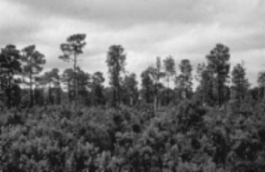
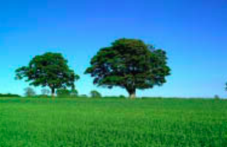
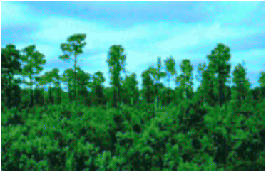

# Colorize

This project aims to compare the execution of a sequential algorithm and its corresponding version using the OpenMP API.

  
  
  

### Program

The Colorize program aims to color an image that is originally in grayscale according to the pixels of another provided image. To do this, it compares the most similar pixels and assigns the color of a pixel from the colored image to the resulting image.

The algorithm used is a simplified version taken from the paper "Transferring Color to Greyscale Images" by Tomihisa Welsh, Michael Ashikhmin, and Klaus Mueller. A PDF with the original article is at the root of this repository.

Note: For code standardization, it is assumed that all images used must be PNG.

### Dependencies

- GCC
- OpenMP
- Make
- stb_image library

### Installation Commands

To compile the program using the concurrent version, use:
`make`

To compile the program using the sequential version, use:
`make seq`

To remove the compiled program, use:
`make clean`

### Execution Commands

To run the program, use the command below, where grayscale.png is the path to the image that should be colorized, colorful.png is the reference colored image used as the source of colors, output.png is the name of the resulting image, and number_of_threads is the number of threads chosen for the concurrent algorithm.

Sequential:

`./colorize grayscale.png colorful.png output.png`

Concurrent:

`./colorize grayscale.png colorful.png output.png number_of_threads`
